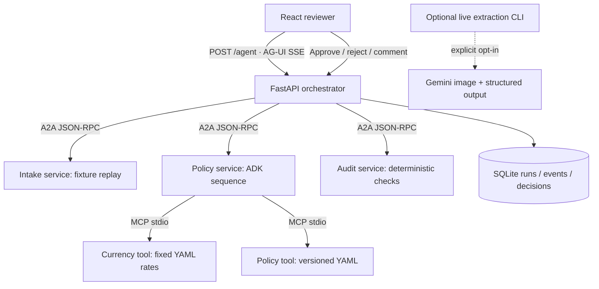

# Multi-Agent Expense Auditor

A small expense-review portfolio project: three A2A agent services collect receipt evidence, check policy through MCP tools, and assemble findings for a human reviewer. React displays AG-UI progress and saves approve/reject/comment decisions in SQLite.

**Default mode is fully offline fixture replay. No API key or model calls are needed.** All data is synthetic. Approval records a review decision; it never reimburses or transfers money.

## Run locally

Python 3.12+ and Node 22 are recommended.

```sh
python3 -m venv .venv
source .venv/bin/activate
pip install -r requirements.txt
npm ci --prefix web
npm run build --prefix web
python -m auditor.dev
```

Open [the reviewer](http://localhost:5190). The launcher starts intake, policy and audit on ports 8211–8213 and the reviewer on 5190. Ctrl-C stops these four services. For frontend development, run `npm run dev --prefix web` on 5191 while those services are running.

Docker alternative:

```sh
docker compose up --build -d
```

Open [the Docker reviewer](http://localhost:5192). Only the reviewer port is exposed, bound to loopback. Agent services communicate on the Compose network. Run `docker compose down` to stop; the named volume keeps review history. No Gemini key is passed into the containers.

## Architecture



The orchestrator executes intake → policy → audit with bounded HTTP timeouts. All three agents publish `/.well-known/agent-card.json`; A2A requests use `SendMessage` and `A2A-Version: 1.0`. This is real protocol communication, with no model-based agent routing. The UI implements the emitted subset of AG-UI: run, step, state snapshot and error events. Review decisions are ordinary application API calls, not an invented AG-UI event.

## Measured results, not targets

Results are from the complete **10-report offline suite**, with fixture receipt fields. See [raw results](docs/offline-results.json).

| Metric | Spec target / scope | Measured MVP |
|---|---|---|
| Dataset | 200 receipts / 50 reports | 20 synthetic receipts / 10 reports |
| Completed offline workflows | All reports | 10 / 10 |
| Seeded-issue recall | ≥92% | 7 / 7 = **100%** |
| Flag precision | No target asserted | 7 / 8 = **87.5%** |
| Clean reports incorrectly flagged | Track false positives | 0 / 3 |
| Receipt field extraction | ≥94% | **Not measured**; fixture replay is not OCR |
| Human review time | 15 → 3 minutes | **Not measured**; no timed study |
| Model calls in offline benchmark | Zero | **0** |

One extra duplicate warning appears on the equal-value split-charge case. This is a known fingerprint limitation, not a hidden failing report. Seven seeded issues cover meal limit, missing receipt, alcohol, duplicate, split-charge review, weekend review and claim mismatch. The suite is deliberately small and was used during development; these figures are not production accuracy or held-out test performance. The extraction grader checks six fields and does not score line items.

## Tests and evaluation

```sh
pytest -q
ruff check .
ruff format --check .
python -m evals.run
npm run build --prefix web
```

Local verification: **16 tests passed**, lint and React production build passed, and a Docker end-to-end smoke report passed. Two dependency deprecation notices are documented in the milestone notes. Hosted CI has not been run.

The benchmark reports metrics without requiring perfect precision; it exits nonzero if any workflow fails. Regression tests separately cover numeric boundaries, schema rejection, true protocol integration, durable review, conflicting decisions and failed runs. CI runs offline only and needs no secrets. [Milestone notes and interview guide](docs/MILESTONES.md) explain each important file, design choice and limitation.

Regenerate fixtures with `python -m data.generate`. The missing-receipt case intentionally has an unattached receipt image in the 20-image corpus; only 19 receipt references are attached across reports.

## Two-minute demo

1. Select **Meal over limit**, then **Analyze report**. Watch the three agent steps complete.
2. Open receipt `r05`, expand the finding evidence, and compare the $90 claim with the $75 rule.
3. Add a note and **Reject**. Reload and reopen the saved run; its decision and evidence persist.
4. Analyze **City visit · clean**, inspect its receipts, then **Approve**.
5. Show **Possible split charge** and explain the extra duplicate warning as the measured false positive.

## Optional Gemini experiment — not run for this build

The UI cannot trigger paid model calls. The separate CLI requires explicit opt-in. Only use it after verifying that the Google project has billing disabled and that your selected model has free-tier quota. This code cannot verify your billing configuration.

```sh
cp .env.example .env
# Set GEMINI_API_KEY locally in .env; do not paste it into source code or GitHub.
python -m evals.live_extract --confirm-free-tier --limit 1
```

The configured SDK is `google-genai==2.25.0`, with `GEMINI_MODEL=gemini-3.8-flash` as the current project default verified during this build. Availability and free-tier quotas can change; check the official model and pricing pages before a live run. The CLI stops on its first provider/validation error and does not switch models or retry. Results go to ignored `results/live-extraction.json`. Unattempted selected receipts remain in the denominator as missing outputs. No live extraction result is claimed here.

## Scope and references

Local, single-user demonstration only: no authentication, public deployment, private client data or payment actions. Rates are synthetic fixtures, not current foreign-exchange quotes. Duplicate/split checks operate within one report. SQLite and the three-agent fixture pipeline intentionally replace the larger spec's infrastructure until real evaluation justifies expansion.

Official references checked during the build:

- [A2A Python server tutorial](https://a2a-protocol.org/v1.0.0/tutorials/python/5-start-server/) — implementation uses the installed 1.1.5 SDK routes/protobuf API.
- [AG-UI Python events](https://docs.ag-ui.com/sdk/python/core/events).
- [ADK sequential agents](https://adk.dev/agents/workflow-agents/sequential-agents/).
- [Gemini structured outputs](https://ai.google.dev/gemini-api/docs/structured-output), [model catalog](https://ai.google.dev/gemini-api/docs/models), [pricing and free tier](https://ai.google.dev/gemini-api/docs/pricing).
