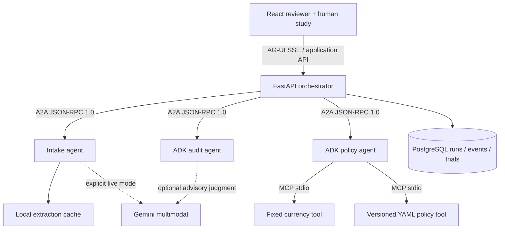

# Multi-Agent Expense Auditor

Three A2A agent services extract synthetic receipts, check policy through MCP tools, and assemble evidence for a human reviewer. React displays AG-UI progress; PostgreSQL stores runs, extracted fields, findings, events, decisions and timing-study trials.

**Default mode stays offline.** Live Gemini requires a configured key from a billing-disabled free-tier project and explicit mode selection. Approval records a review decision; it never transfers money.

## What is implemented

- 200 synthetic receipt PNGs with varied layouts, rotation, blur and crease-like lines; 50 labeled reports, including 15 clean reports.
- Three extraction modes: fixture replay, cached real Gemini results, and live Gemini image extraction with validated structured output. Missing cached data fails; it never falls back to ground truth.
- Two real MCP servers for versioned policy and fixed currency conversion, coordinated by an ADK sequence.
- Per-expense category limits, daily meal limits, receipt thresholds, disallowed items, duplicate/split heuristics, weekend/holiday review and mismatches.
- ADK audit agent with optional cached Gemini advice for ambiguous flags in live mode. Advice cannot remove flags or approve expenses.
- Three separate A2A HTTP services with Agent Cards, a FastAPI orchestrator, AG-UI event stream, receipt evidence and durable approve/reject/comment history.
- PostgreSQL in Docker; SQLite remains available for lightweight local development.
- Human timing study: four cases, each reviewed manually and with assistance, with condition order alternated by participant/case, anonymous codes, durable timers and paired summaries.

## Run the PostgreSQL version

```sh
docker compose up --build -d
```

Open [the full reviewer](http://localhost:5192). The reviewer is bound to loopback; PostgreSQL and agent services are internal to the Compose network. `docker compose stop` stops the stack without deleting its data. The database password in Compose is a local demonstration credential, not a deployment secret.

Optional local development (Python 3.12+, Node 22):

```sh
python3 -m venv .venv
source .venv/bin/activate
pip install -r requirements.txt
npm ci --prefix web
npm run build --prefix web
python -m auditor.dev
```

Open [the development reviewer](http://localhost:5190). This uses SQLite unless `DATABASE_URL` points to PostgreSQL. It starts intake/policy/audit on 8211–8213; Ctrl-C stops these local processes. Docker and local development keep separate review histories. The frontend development server is available with `npm run dev --prefix web` on 5191.

## Gemini configuration and resumable evaluation

Google's official pricing page listed `gemini-3.8-flash` input/output as free of charge on the Free Tier when checked September 27, 2026. A model name alone does **not** prevent billing; the owning Google project must have billing disabled. This program cannot independently verify that setting.

```sh
cp .env.example .env
# Set GEMINI_API_KEY locally, then set GEMINI_FREE_TIER_CONFIRMED=true
# only after checking the owning project's billing status.
python -m evals.live_extract --limit 200 --delay 7
```

The benchmark uses `google-genai==2.25.0`, one request at a time, no SDK retries, no model fallback and a bounded timeout. It stops on the first provider/schema error. Rerun to resume; real outputs are cached by image bytes, model and prompt version. Private keys and raw caches stay ignored by Git. Public aggregate results go to `docs/live-extraction-results.json`.

The reviewer starts in fixture mode. Choose **Live Gemini** to extract a report or **Cached Gemini results** to reuse existing real outputs without new calls. Live ambiguous cases can make one additional advisory call. Docker shares a cache volume between intake/audit/reviewer; the local CLI uses its own `results/` folder. A local benchmark cache is not automatically copied into Docker.

Evaluate the whole receipt-to-flags pipeline from cached model outputs:

```sh
python -m evals.run --mode gemini_cached
```

Missing extracted receipts fail the affected workflow and stay in the evaluation denominator. Extraction accuracy covers six core fields, with line-item list accuracy reported separately. Fixture replay is never described as OCR accuracy.

## Measurements

| Metric | Target | Measured status |
|---|---|---|
| Dataset | 200 receipts / 50 reports | 200 / 50 generated |
| Offline completed workflows | All reports | 50 / 50 |
| Seeded-issue recall | ≥92% | 35 / 35 = **100%**, fixture intake |
| Flag precision | Report transparently | 35 / 40 = **87.5%**, fixture intake |
| Clean reports flagged | Track false positives | 0 / 15 |
| Gemini field extraction | ≥94% | **2 / 200 receipts completed**; 12/12 core fields matched on those two; subsequent HTTP 503 stopped the run |
| Human review time | 15 → 3 minutes | **Not yet established**; actual participant trials required |

[Offline results](docs/offline-results.json) and [live attempt status](docs/live-extraction-results.json) are separate artifacts. Five equal-value split-charge cases also trigger the simple duplicate fingerprint. These known false positives are retained. The expanded corpus repeats controlled scenario families; it is regression coverage, not a held-out production benchmark.

The receipt generator uses Pillow and emits companion HTML references for the additional receipts. It does not use browser-rendered HTML as the PNG renderer. There are 180 report-associated receipt records (five are intentionally unattached for missing-receipt cases) and 20 additional extraction-only receipts. Regenerate everything with `python -m data.expand`; do not regenerate while evaluations are running.

## Run the human study

Click **Timed review study**. Keep the generated anonymous code, read the policy, and click **Start timed review** when ready. Complete all eight reviews. The app resumes unfinished/completed assignments for the same participant code after a reload. Invite two or three volunteers to use different codes. Use one evidence mode per participant.

Timers start after evidence preparation and stop at the participant's decision; interruptions count toward elapsed time. The summary compares completed manual/assisted pairs and reports decision agreement as well as time. Model latency is excluded. Results from fixture fields are a workflow study, not a live OCR study. Repeated cases introduce familiarity effects even with order balancing. See [study protocol](docs/TIMING_STUDY.md).

## Architecture



A2A connects the separate agent services; MCP exposes tools; AG-UI carries run/step/state/error events to React. Review and study submissions are ordinary application endpoints. Agent Cards advertise capabilities, but calls stay on configured URLs. Model/provider errors are sanitized before display.

## Verification and demo

```sh
pytest -q
ruff check .
ruff format --check .
python -m evals.run
npm run build --prefix web
```

The optional PostgreSQL pytest test runs when `TEST_POSTGRES_URL` is configured; CI starts an isolated PostgreSQL service and disables live calls. Local verification passed 23 tests, with the PostgreSQL test skipped locally; a separate real Docker/PostgreSQL integration check passed. Hosted CI has not been run. Dependency deprecation notices are documented in the milestone guide.

Demo: analyze **Meal over limit**, inspect `r05`, review the cited $75 threshold and reject with a note. Reopen the saved run. Show a clean report and then **Possible split charge** to explain the measured false positive. Finally show the study page and the difference between targets and actual measurements.

[Milestone and interview guide](docs/MILESTONES.md) explains the key files and remaining limits. This remains a local portfolio application: no public deployment hardening, authentication, arbitrary uploads, cross-report duplicate search or payment execution.

Official references checked for this implementation: [A2A Python server](https://a2a-protocol.org/v1.0.0/tutorials/python/5-start-server/), [AG-UI events](https://docs.ag-ui.com/sdk/python/core/events), [ADK sequential agents](https://adk.dev/agents/workflow-agents/sequential-agents/), [Gemini structured output](https://ai.google.dev/gemini-api/docs/structured-output), [Gemini pricing/free tier](https://ai.google.dev/gemini-api/docs/pricing).
